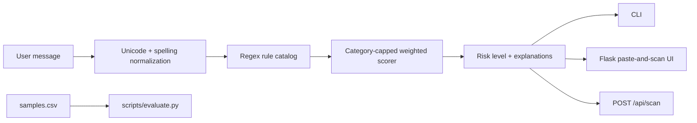

# ScamGuard

[](https://github.com/specter-sec/scamguard/actions/workflows/tests.yml)
[](LICENSE)
[](https://www.python.org/)

**ScamGuard** is an open-source, explainable screening toolkit for scam messages written in Roman Urdu, Urdu, and Hinglish. It checks common SMS, WhatsApp, social-media, payment-service, and crypto scam patterns with a small weighted rule engine. It is designed to run locally and does not need a model API or send message text to a third party.

> A result is a warning signal, not a verdict. “SAFE” means no configured rule matched; it does not prove a message is genuine. Never share an OTP, PIN, password, or full CNIC because an unsolicited message asks for it.

## What it checks

The starter rules cover urgency and deadlines; prize, lottery, and advance-fee bait; OTP, PIN, password, verification-code, and CNIC requests; account-block threats; guaranteed crypto-return and airdrop claims; BISP, Ehsaas, Easypaisa, and JazzCash impersonation patterns; shortened links; and selected unusual domain suffixes. Roman Urdu variants such as `foran` / `furan` and `inaam` / `inam` are normalized, with a starter alias map for common Urdu-script terms.

Every rule is visible in [`scamguard/rules.py`](scamguard/rules.py). A rule contributes its weight once per message. Points are added per category, bounded by that category's cap, then summed to a 0–100 score:

- **SAFE:** 0–24
- **SUSPICIOUS:** 25–59
- **HIGH RISK:** 60–100

Thresholds can be changed when constructing `ScamDetector`. Tune them against representative, consented data before relying on them operationally.

## Installation

Python 3.10 or newer is required.

```bash
git clone https://github.com/specter-sec/scamguard.git
cd scamguard
python -m venv .venv
source .venv/bin/activate       # Windows: .venv\Scripts\activate
python -m pip install --upgrade pip
pip install -r requirements.txt
pip install -e .
```

## Usage

### Command line

```bash
python -m scamguard scan "Mubarak! Aap ka inaam nikla hai, foran claim karein."
python -m scamguard scan --json "Apna OTP bhejo warna account block ho jayega."
cat message.txt | python -m scamguard scan
```

The CLI prints the risk level, score, and triggered rule explanations. It never logs the message body.

### Web interface

```bash
python -m scamguard web
# Open http://127.0.0.1:5000
```

Bind to localhost by default. Use `--host 0.0.0.0` only when you understand that other devices on the network may access the app. Do not expose this development server directly to the public internet.

### REST API

`POST /api/scan` accepts JSON with a string `text` field and returns a JSON result. Requests over 10,000 message characters are rejected.

```bash
curl -s http://127.0.0.1:5000/api/scan \
  -H 'Content-Type: application/json' \
  -d '{"text":"Apna OTP bhejo warna account block ho jayega."}'
```

Example response for the command above (fields abbreviated):

```json
{
  "risk_level": "HIGH RISK",
  "score": 60,
  "explanations": [
    "The message threatens blocking, suspension, or loss of account access.",
    "The message asks for an OTP, PIN, CNIC, password, or verification code."
  ],
  "triggered_rules": [
    {
      "rule_id": "threat_account_action",
      "category": "account-block threat",
      "title": "Threat of account action",
      "weight": 26,
      "matched_text": "account block"
    },
    {
      "rule_id": "credential_request",
      "category": "OTP / PIN / CNIC phishing",
      "title": "Request for sensitive credentials",
      "weight": 34,
      "matched_text": "apna otp bhejo"
    }
  ]
}
```

The score is based on the default rules and thresholds.

### Python API

```python
from scamguard import ScamDetector

result = ScamDetector().scan("Apna OTP bhejo warna account block ho jayega.")
print(result.risk_level.value, result.score)
for rule in result.triggered_rules:
    print(rule.title, "—", rule.explanation)
```

## Evaluation

Run the curated starter sample evaluation:

```bash
python scripts/evaluate.py
```

It reports binary **accuracy**, **precision**, and **recall** (positive means `SUSPICIOUS` or `HIGH RISK`) plus confusion counts. `samples.csv` is a small hand-curated regression set, not a statistically representative benchmark. Its metrics must not be presented as real-world effectiveness. Expand it with reviewed, privacy-safe examples and split evaluation data before making performance claims.

## Tests and style

```bash
pytest -q
flake8 .
```

The GitHub Actions workflow runs both checks on Python 3.10–3.12 for pushes and pull requests.

## Architecture



The core is intentionally dependency-light: the rule engine and CLI use the Python standard library, while Flask is required for the web application and API.

## Project structure

```text
scamguard/                         # repository root
├── .github/workflows/tests.yml    # pytest + flake8 CI
├── .gitignore
├── CHANGELOG.md
├── CONTRIBUTING.md
├── LICENSE
├── MANIFEST.in
├── README.md
├── pyproject.toml
├── requirements.txt
├── samples.csv
├── setup.cfg
├── docs/screenshots/README.md
├── scamguard/                     # installable Python package
│   ├── __init__.py
│   ├── __main__.py
│   ├── cli.py
│   ├── engine.py
│   ├── models.py
│   ├── normalization.py
│   ├── rules.py
│   ├── web.py
│   ├── static/style.css
│   └── templates/index.html
├── scripts/evaluate.py
└── tests/
    ├── test_engine.py
    └── test_web.py
```

## Screenshots

The web interface can be previewed locally with the command above. Screenshots are not included in this review draft; add current, non-sensitive captures here after the interface is reviewed. Do not use real private messages or personal details in published screenshots.

## Privacy and limitations

By default, the detector analyzes only the text passed to it; the package has no network client and does not persist scans. A deployed Flask instance may still log request metadata through its host or proxy, so configure production logging and retention accordingly. This prototype does not inspect link destinations, verify sender identity, or use machine learning. Scammers change wording and may use new spellings, languages, or channels; false positives and false negatives are expected. Verify payment, benefit, account, and wallet notices using a phone number or website obtained independently from the official organization.

## Contributing

See [CONTRIBUTING.md](CONTRIBUTING.md) for rules, tests, data, and pull-request guidance. The project is licensed under the MIT License; see [LICENSE](LICENSE).
